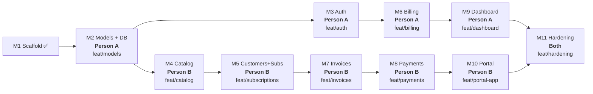

# Brightloop — Two-Person Task Distribution

## Team Roles

| | **Person A — "Core & Ops"** | **Person B — "Business & Portal"** |
|---|---|---|
| **Owns** | Auth, Billing engine, Dashboard/Reports, Ops frontend | Catalog, Customers, Subscriptions, Invoices, Payments, Portal frontend |
| **Primary directories** | `server/src/middleware/`, `server/src/jobs/`, `server/src/seeders/`, `ops/src/pages/`, `ops/src/components/` | `portal/src/pages/`, `portal/src/components/`, catalog & transaction controllers/services/routes |
| **Server routes** | `/api/auth/*`, `/api/ops/billing/*`, `/api/ops/dashboard/*`, `/api/ops/reports/*`, `/api/ops/staff/*` | `/api/ops/products/*`, `/api/ops/plans/*`, `/api/ops/taxes/*`, `/api/ops/discounts/*`, `/api/ops/templates/*`, `/api/ops/customers/*`, `/api/ops/subscriptions/*`, `/api/ops/invoices/*`, `/api/ops/payments/*`, `/api/portal/*` |

---

## Phase Plan



---

## Phase 1 — Foundation (Sequential)

> [!IMPORTANT]
> **Person A** does M2 alone. Person B can start prepping catalog UI mockups / component shells but does NOT touch server code yet. Merge `feat/models` → `main` before Phase 2.

### M2 — Models + DB *(Person A, branch: `feat/models`)*

| Task | Files |
|------|-------|
| All Sequelize models (User, RefreshToken, Customer, Product, ProductVariant, Plan, Tax, PaymentTerm, QuotationTemplate, TemplateLine, Subscription, SubscriptionLine, Discount, DiscountProduct, SubscriptionDiscount, Invoice, InvoiceLine, Payment, AuditLog, Sequence) | `server/src/models/*.js` |
| Model registry + associations | `server/src/models/index.js` |
| Umzug migration setup + initial migration | `server/src/migrations/` |
| Seeders (admin user, taxes, payment terms) | `server/src/seeders/` |
| Money utility | `server/src/utils/money.js` |
| Numbering utility | `server/src/utils/numbering.js` |

**Merge checkpoint:** Server starts, `sequelize.authenticate()` passes, seeder runs, tables exist in Aiven.

---

## Phase 2 — Parallel Work Begins

> [!NOTE]
> After `feat/models` is merged to `main`, both developers branch from the **updated main**. They work in parallel on completely different files.

### Person A: M3 — Auth *(branch: `feat/auth`)*

| Task | Files touched |
|------|---------------|
| Auth controllers (register, login, refresh, logout, forgot, reset, me) | `server/src/controllers/auth.controller.js` |
| Auth service (password hashing, JWT, refresh rotation, reset tokens) | `server/src/services/auth.service.js` |
| Auth validators (Zod schemas) | `server/src/validators/auth.validator.js` |
| Auth routes | `server/src/routes/auth.js` |
| Staff CRUD (admin only) | `server/src/controllers/staff.controller.js`, `server/src/services/staff.service.js`, `server/src/routes/ops/staff.js` |
| Middleware: `authenticate.js`, `authorize.js`, `validate.js` | `server/src/middleware/` |
| Rate limiting middleware | `server/src/middleware/rateLimit.js` |
| Mail config + service | `server/src/config/mail.js`, `server/src/services/mail.service.js` |
| **Ops frontend**: Login page, ProtectedRoute, auth pages (forgot/reset) | `ops/src/pages/Login/`, `ops/src/pages/ForgotPassword/`, `ops/src/pages/ResetPassword/`, `ops/src/routes/` |
| **Portal frontend**: Register, Login, ForgotPassword, ResetPassword pages | `portal/src/pages/Login/`, `portal/src/pages/Register/`, `portal/src/pages/ForgotPassword/`, `portal/src/pages/ResetPassword/` |
| Auth RTK Query endpoints (both apps) | `*/src/services/endpoints/authApi.js` |
| `App.jsx` + routing setup (both apps) | `*/src/App.jsx`, `*/src/routes/index.jsx` |

### Person B: M4 — Catalog *(branch: `feat/catalog`)*

| Task | Files touched |
|------|---------------|
| Product controller + service + validator + routes | `server/src/controllers/product.controller.js`, `server/src/services/product.service.js`, `server/src/validators/product.validator.js`, `server/src/routes/ops/products.js` |
| Plan controller + service + validator + routes | `server/src/controllers/plan.controller.js`, `server/src/services/plan.service.js`, `server/src/validators/plan.validator.js`, `server/src/routes/ops/plans.js` |
| Tax controller + service + validator + routes | `server/src/controllers/tax.controller.js`, `server/src/services/tax.service.js`, `server/src/validators/tax.validator.js`, `server/src/routes/ops/taxes.js` |
| PaymentTerm controller + service + validator + routes | `server/src/controllers/paymentTerm.controller.js`, `server/src/services/paymentTerm.service.js`, `server/src/routes/ops/paymentTerms.js` |
| Discount controller + service + validator + routes | `server/src/controllers/discount.controller.js`, `server/src/services/discount.service.js`, `server/src/validators/discount.validator.js`, `server/src/routes/ops/discounts.js` |
| Template controller + service + validator + routes | `server/src/controllers/template.controller.js`, `server/src/services/template.service.js`, `server/src/validators/template.validator.js`, `server/src/routes/ops/templates.js` |
| **Ops frontend**: Products, Plans, Taxes, PaymentTerms, Discounts, Templates pages | `ops/src/pages/Products/`, `ops/src/pages/Plans/`, `ops/src/pages/Taxes/`, `ops/src/pages/PaymentTerms/`, `ops/src/pages/Discounts/`, `ops/src/pages/Templates/` |
| Catalog RTK Query endpoints | `ops/src/services/endpoints/productApi.js`, `planApi.js`, `taxApi.js`, `discountApi.js`, `templateApi.js`, `paymentTermApi.js` |

> [!TIP]
> Person B will use the `authenticate` and `authorize` middleware created by Person A. If Person A's auth branch isn't merged yet, Person B can **temporarily skip auth middleware** on their routes and add it once `feat/auth` lands.

---

## Phase 3 — Deeper Features (Parallel)

After merging `feat/auth` and `feat/catalog` → `main`, both rebase.

### Person A: M6 — Billing Engine *(branch: `feat/billing`)*

| Task | Files touched |
|------|---------------|
| Billing service (the core engine) | `server/src/services/billing.service.js` |
| Discount application service | `server/src/services/discount.service.js` *(if not already by B)* |
| Tax calculation service | `server/src/services/tax.service.js` *(if not already by B)* |
| Billing job (cron) | `server/src/jobs/billing.job.js` |
| Overdue job (cron) | `server/src/jobs/overdue.job.js` |
| Billing routes | `server/src/routes/ops/billing.js` |
| Billing tests | `server/src/tests/billing.test.js` |
| Register cron in `server.js` | `server/src/server.js` *(add cron startup — one-line addition)* |

### Person B: M5 — Customers + Subscriptions *(branch: `feat/subscriptions`)*

| Task | Files touched |
|------|---------------|
| Customer controller + service + validator + routes | `server/src/controllers/customer.controller.js`, `server/src/services/customer.service.js`, `server/src/validators/customer.validator.js`, `server/src/routes/ops/customers.js` |
| Subscription controller + service + validator + routes | `server/src/controllers/subscription.controller.js`, `server/src/services/subscription.service.js`, `server/src/validators/subscription.validator.js`, `server/src/routes/ops/subscriptions.js` |
| State machine logic (transitions, pause, renew, close) | inside `subscription.service.js` |
| Audit log service | `server/src/services/audit.service.js` |
| **Ops frontend**: Customers list/detail, Subscriptions list/detail/builder, status stepper | `ops/src/pages/Customers/`, `ops/src/pages/Subscriptions/`, `ops/src/components/StatusStepper/` |
| RTK Query endpoints | `ops/src/services/endpoints/customerApi.js`, `subscriptionApi.js` |

---

## Phase 4 — Transactions (Parallel)

### Person A: M9 — Dashboard & Reports *(branch: `feat/dashboard`)*

| Task | Files touched |
|------|---------------|
| Dashboard controller + service | `server/src/controllers/dashboard.controller.js`, `server/src/services/dashboard.service.js` |
| Reports controller + service | `server/src/controllers/report.controller.js`, `server/src/services/report.service.js` |
| Dashboard + report routes | `server/src/routes/ops/dashboard.js`, `server/src/routes/ops/reports.js` |
| **Ops frontend**: Dashboard page, Reports pages, charts/cards | `ops/src/pages/Dashboard/`, `ops/src/pages/Reports/`, `ops/src/components/DashCard/`, `ops/src/components/Chart/` |
| RTK Query endpoints | `ops/src/services/endpoints/dashboardApi.js`, `reportApi.js` |

### Person B: M7 + M8 — Invoices + Payments *(branch: `feat/invoices-payments`)*

| Task | Files touched |
|------|---------------|
| Invoice controller + service + routes | `server/src/controllers/invoice.controller.js`, `server/src/services/invoice.service.js`, `server/src/routes/ops/invoices.js` |
| Invoice print view (HTML) | `server/src/services/invoicePrint.service.js` |
| Payment controller + service + routes | `server/src/controllers/payment.controller.js`, `server/src/services/payment.service.js`, `server/src/routes/ops/payments.js` |
| **Ops frontend**: Invoice list/detail/print, Payment recording | `ops/src/pages/Invoices/`, `ops/src/pages/Payments/`, `ops/src/components/InvoicePrint/` |
| RTK Query endpoints | `ops/src/services/endpoints/invoiceApi.js`, `paymentApi.js` |

---

## Phase 5 — Portal + Hardening

### Person B: M10 — Portal *(branch: `feat/portal-app`)*

| Task | Files touched |
|------|---------------|
| Portal API routes | `server/src/routes/portal/me.js`, `subscriptions.js`, `invoices.js`, `plans.js` |
| Portal controllers + services | `server/src/controllers/portal.*.controller.js`, `server/src/services/portal.*.service.js` |
| **Portal frontend**: My Subscriptions, My Invoices, Profile, Plan browser | `portal/src/pages/Subscriptions/`, `portal/src/pages/Invoices/`, `portal/src/pages/Profile/`, `portal/src/pages/Plans/` |
| Portal layout + navigation | `portal/src/components/Layout/`, `portal/src/components/Sidebar/` |
| RTK Query endpoints | `portal/src/services/endpoints/` |

### Person A: Ops Layout + Staff Management

| Task | Files touched |
|------|---------------|
| Ops app layout + sidebar + navigation | `ops/src/components/Layout/`, `ops/src/components/Sidebar/`, `ops/src/components/Header/` |
| Staff management pages (admin) | `ops/src/pages/Staff/` |
| RTK Query endpoints | `ops/src/services/endpoints/staffApi.js` |

### M11 — Hardening *(Both, branch: `feat/hardening`)*

> [!IMPORTANT]
> Work on this together or split by app: Person A hardens ops + server security, Person B hardens portal + accessibility.

| Person A | Person B |
|----------|----------|
| Rate limiting on all auth routes | Accessibility pass (labels, focus, keyboard nav) |
| Audit log completeness | Empty/loading/error states across portal |
| Server error logging + `Server-Timing` | Toast notifications for mutation failures |
| Security review (Helmet, CORS, Zod strict) | Responsive tables + mobile layout |
| README.md | Final CSS/token audit |

---

## Conflict-Prone Files — Protocol

These files are touched by **both** people. Follow these rules to avoid merge conflicts:

### 1. `server/src/routes/index.js` — Route Registry

**Rule: append-only, own section.** Each person adds their route imports in a clearly marked block:

```js
// ── Person A routes ──
import authRoutes from './auth.js';
import staffRoutes from './ops/staff.js';
import billingRoutes from './ops/billing.js';
import dashboardRoutes from './ops/dashboard.js';
import reportRoutes from './ops/reports.js';

// ── Person B routes ──
import productRoutes from './ops/products.js';
import planRoutes from './ops/plans.js';
// ... etc
```

### 2. `server/src/models/index.js` — Model Registry

**Rule: Person A sets this up once in M2.** After that, both only **add** import lines + association calls. Use the same block pattern:

```js
// ── Identity models (Person A) ──
import User from './User.js';
// ...

// ── Catalog models (Person B) ──
import Product from './Product.js';
// ...
```

### 3. `*/src/App.jsx` — Route Definitions

**Rule: Person A owns the initial route structure.** Person B adds their routes inside a clearly marked `{/* Person B routes */}` comment block.

### 4. `shared/constants/index.js`

**Rule: append-only.** If you need new constants, add them at the bottom of the file with a comment.

### 5. `server/src/server.js`

**Rule: Person A owns this file.** Person B should not need to touch it. If Person B needs server-level changes, coordinate via PR comment.

---

## Branch Strategy

```
main
 ├── feat/models          (Person A → merge first)
 │
 ├── feat/auth            (Person A, from updated main)
 ├── feat/catalog         (Person B, from updated main)
 │
 ├── feat/billing         (Person A, after auth merges)
 ├── feat/subscriptions   (Person B, after catalog merges)
 │
 ├── feat/dashboard       (Person A, after billing merges)
 ├── feat/invoices-payments (Person B, after subscriptions merges)
 │
 ├── feat/portal-app      (Person B, after invoices-payments merges)
 │
 └── feat/hardening       (Both, final)
```

### Merge Rules

1. **Always merge to `main` via Pull Request** — the other person reviews
2. Before starting a new branch, **pull latest `main`** and branch from it
3. If your branch falls behind `main`, **rebase** (not merge) to keep history clean
4. Run `npm run dev:server` + one frontend before each PR to confirm nothing breaks
5. Commit messages: `feat:`, `fix:`, `chore:` prefix per milestone

---

## Timeline Summary

| Phase | Person A | Person B | Parallel? |
|-------|----------|----------|-----------|
| **1** | M2 Models + DB | Prep catalog UI shells (no server) | ⚠️ Limited |
| **2** | M3 Auth (full stack) | M4 Catalog (full stack) | ✅ Full |
| **3** | M6 Billing engine | M5 Customers + Subscriptions | ✅ Full |
| **4** | M9 Dashboard + Reports | M7 Invoices + M8 Payments | ✅ Full |
| **5** | Ops layout + Staff mgmt | M10 Portal app | ✅ Full |
| **6** | M11 Hardening (server/ops) | M11 Hardening (portal/a11y) | ✅ Split |
